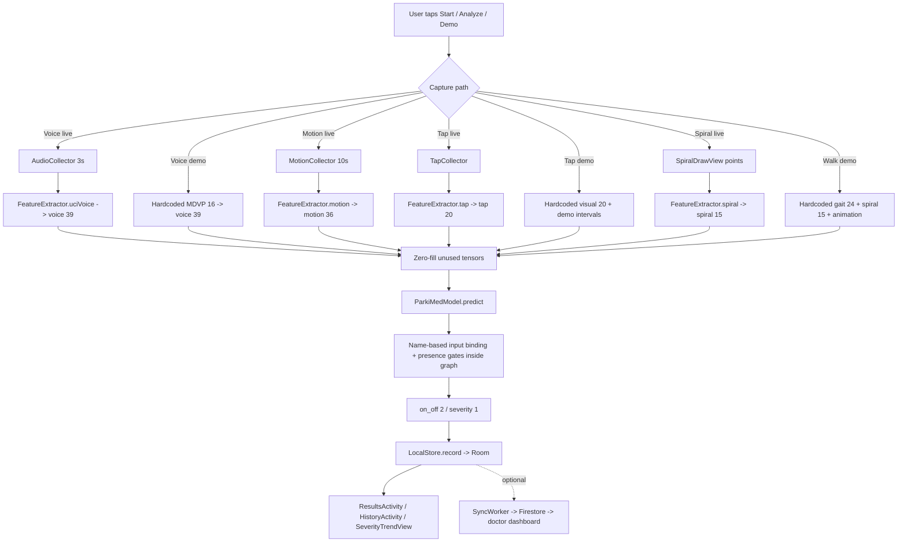
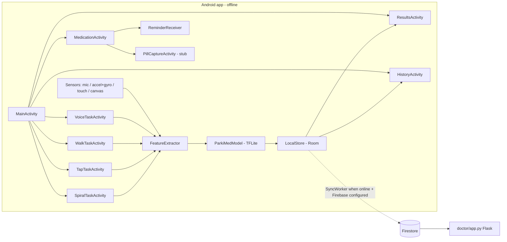
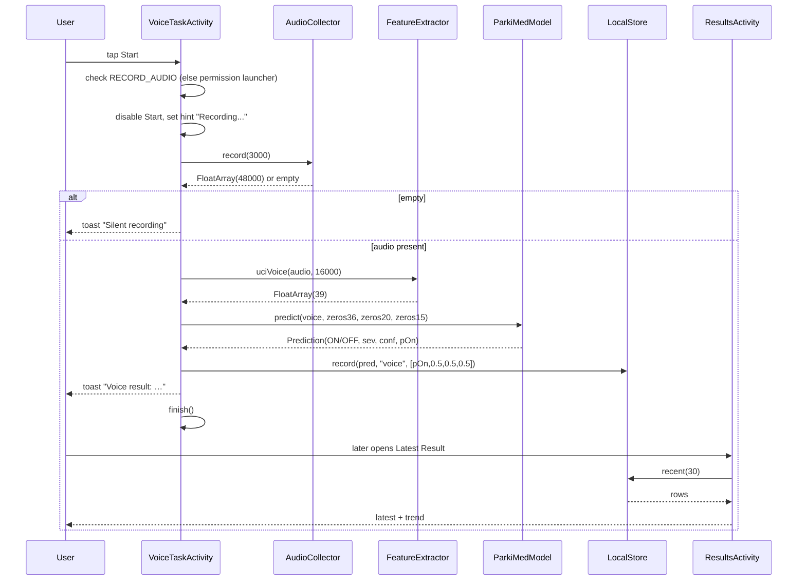
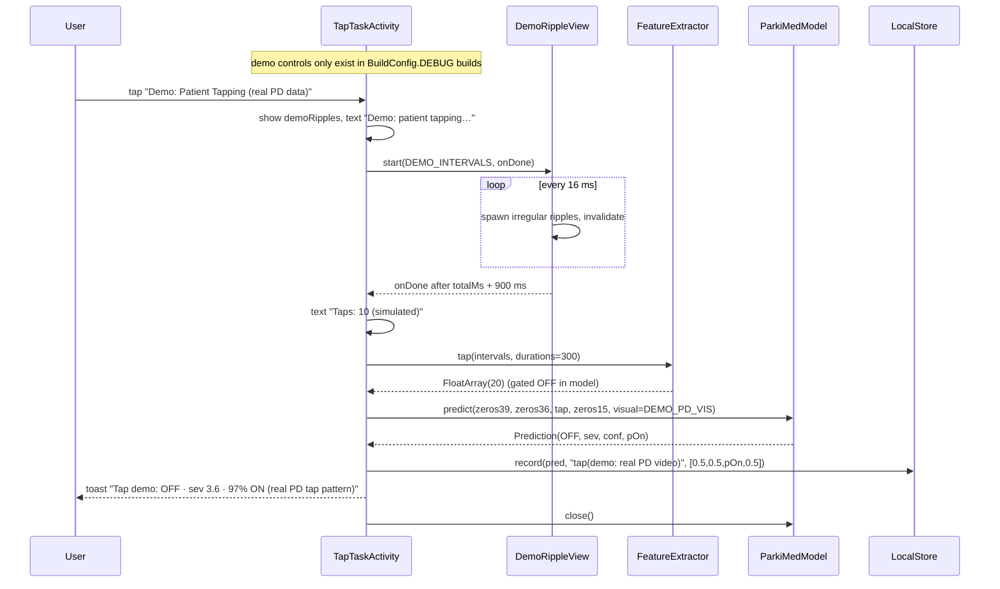
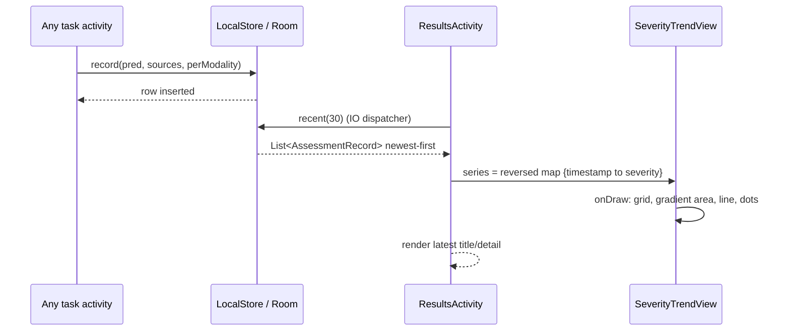
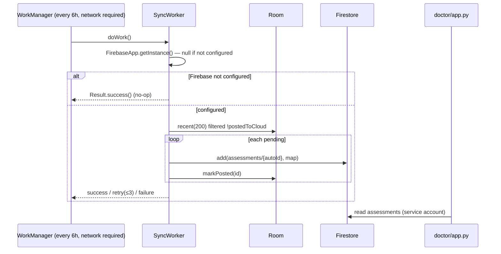

# ParkiMed — Technical Handover for the UI Developer

**Document scope:** describes the application **as it actually exists in this repository**, so a new developer can redesign the UI without breaking behaviour.
**Last verified against:** the working tree at commit `8e03fee` (model v3, Android app verified on a physical Vivo device).
**Audience:** a frontend/Android UI developer who will replace the current screens with a polished design.

> **Read this first — brief vs. reality.**
> A separate design brief circulated with this project mentions *skeleton keypoints with real/not-real labels*, a *smile* control, a *frontend↔backend API*, and a *"Download ROC-HCI video"* button.
> **None of those exist in this codebase.** The closest real features are: a hand-drawn **stick-figure gait animation** (`GaitView`), a **finger-tapping task** (`TapTaskActivity`, no smile feature anywhere), a **fully offline on-device model** (no backend API), and **ROC-HCI tap-feature CSVs** (no video download).
> This document maps every brief term to the real implementation in [§12](#12-brief-vs-reality-mapping). Do not invent the missing pieces; treat them as *proposed* work.

---

## 1. Project Overview

| Item | Value |
|---|---|
| **Project name** | ParkiMed — *Adaptive Multimodal Fusion Framework for Smartphone-Based Medication Monitoring for Parkinson's Disease* |
| **Type** | B.Tech AI & ML final-year project (also intended as a real assistive tool) |
| **Platform** | Android 10+ (minSdk 29), fully offline, optional cloud sync |
| **Repository root** | `parkimed-ai/` |
| **App module** | `ParkiMed-Android/` (single Gradle module `:app`) |
| **Package** | `com.parkimed.ai` |

### Problem solved
People with Parkinson's disease fluctuate between **ON** (medication working, symptoms controlled) and **OFF** (medication wearing off, symptoms return) states several times a day. Motor symptoms also vary in severity. Patients and clinicians currently rely on intermittent clinic visits and subjective diaries.

ParkiMed records four short, phone-based motor tasks, extracts clinical-style features, runs a **TensorFlow Lite fusion model on-device**, and reports:

- **Medication state:** `ON` or `OFF`
- **Severity:** a 0–5 score
- **Confidence:** 0–1
- **Per-modality probability** (explainability panel)
- **History + severity trend**

No data leaves the phone unless the optional Firebase sync is configured.

### Intended users
- **Patient** — runs a 3–30 s task with guided instructions, sees a plain result.
- **Caregiver** — checks history/trend, sets medication reminders.
- **Clinician (optional)** — the separate Flask dashboard `doctor/app.py` reads synced Firestore records.
- **Examiner/demo audience** — the debug-only demo buttons replay real patient-derived feature vectors.

### End-to-end workflow
```
Home → pick task → capture (mic / accelerometer / touch / canvas)
     → FeatureExtractor (fixed-size float vector)
     → ParkiMedModel.predict()  (TFLite, on-device)
     → Prediction(ON/OFF, severity, confidence, pOn)
     → LocalStore (Room) → Results / History / SeverityTrendView
                       → (optional) SyncWorker → Firestore → doctor dashboard
```

### Implementation status (verified from source)

| Feature | Status | Evidence |
|---|---|---|
| Voice task (live mic → real MDVP features → model) | **Implemented, device-verified** | `VoiceTaskActivity`, `AudioCollector`, `FeatureExtractor.uciVoice` |
| Spiral task (live drawing → real spiral head) | **Implemented, device-verified** | `SpiralTaskActivity`, `SpiralDrawView`, `FeatureExtractor.spiral` |
| Gait/visual demo path (real REMAP + ROC-HCI vectors) | **Implemented, device-verified** | `WalkTaskActivity` demo, `TapTaskActivity` demo |
| Severity + ON/OFF output, local Room persistence | **Implemented** | `ParkiMedModel`, `LocalStore`, `AssessmentRecord` |
| Latest result + 30-point severity trend | **Implemented** | `ResultsActivity`, `SeverityTrendView` |
| Assessment history list | **Implemented** (plain `ListView`) | `HistoryActivity` |
| Daily medication reminder (AlarmManager) | **Implemented** (no boot re-registration) | `MedicationActivity`, `ReminderReceiver` |
| Pill-intake camera verification | **UI stub only** — CameraX preview, no detector, no DB write | `PillCaptureActivity` (explicit `TODO`) |
| Cloud sync to Firestore → doctor dashboard | **Implemented but inactive** — requires `google-services.json` (not shipped) | `SyncWorker`, `doctor/app.py` |
| Live accelerometer gait test (`WalkTaskActivity` Start button) | **Runs, but prediction is gated off** → always ~50/50 | see [§5.6](#56-why-live-motion-and-live-tap-produce-a-neutral-result) |
| Live in-app tap test (`TapTaskActivity` Analyze) | **Runs, but prediction is gated off** → always ~50/50 | same |
| Demo buttons (Voice Healthy/Severe, Tap, Walk) | **Implemented, debug builds only** | `BuildConfig.DEBUG` gating |
| Spiral demo button | **Does not exist** | — |
| Smile feature | **Does not exist** | — |
| ROC-HCI video download | **Does not exist** | — |
| Backend API / REST endpoints | **Does not exist** (offline app) | — |

---

## 2. Technology Stack

### Android app

| Layer | Technology | What it does here |
|---|---|---|
| Language | **Kotlin 2.0.21** | All app code |
| Build | **Android Gradle Plugin 8.7.3**, Gradle 8.9, JDK 17 | `ParkiMed-Android/build.gradle.kts`, `app/build.gradle.kts` |
| UI toolkit | **Android Views + XML layouts + ViewBinding** (`com.parkimed.ai.databinding.*`) | No Compose, no Fragments; each screen is an `AppCompatActivity` |
| Design system base | **Material 3 dark** (`Theme.Material3.Dark.NoActionBar`) + custom colors | `res/values/themes.xml`, `colors.xml` |
| On-device ML | **TensorFlow Lite 2.14.0** (`org.tensorflow:tensorflow-lite`) | Loads `assets/parkimed_model.tflite` via `MappedByteBuffer`, CPU, 4 threads |
| Local storage | **Room 2.6.1** (+ KSP) | `assessments` table, offline-first |
| Async | **Kotlin Coroutines 1.8.1** | DB writes, model-adjacent work |
| Background work | **WorkManager 2.9.1** | Periodic (6 h) Firestore sync when online |
| Cloud (optional) | **Firebase BOM 33.2.0** (`firestore-ktx`, `auth-ktx`) + `kotlinx-coroutines-play-services` | Only initialised if `google-services.json` exists |
| Camera (stub) | **CameraX 1.3.4** (`camera-core/camera2/lifecycle/view`) | Preview surface in `PillCaptureActivity` only |
| Charts | **None** — custom `Canvas` view | `SeverityTrendView` draws its own line chart (the old Android README claiming MPAndroidChart is stale) |

### Python (offline training / export — not shipped in the APK)

| Layer | Technology | Role |
|---|---|---|
| Language | Python 3 | `src/` |
| DL | **TensorFlow / Keras** | Trains heads, builds fused graph, exports float16 TFLite |
| Data | **pandas, NumPy, scikit-learn** | CSV loading, scaling, holdout splits |
| Reporting | pypandoc + WeasyPrint (see `reports/`) | Project report PDF |
| Dashboard | **Flask** (`doctor/app.py`) | Reads Firestore, renders patient tables |

Dependency manifests: `requirements.txt` (Python), `ParkiMed-Android/app/build.gradle.kts` (Android). There is **no** `package.json`, `pyproject.toml`, or web frontend.

### Runtime requirements
- Android: phone with **accelerometer, gyroscope, microphone** (declared `required="true"`).
- Build machine: JDK 17, Android SDK with **compileSdk 35**, platform-tools.
- **No `gradlew` wrapper is committed** — use a local Gradle 8.9 (see [§9](#9-build-run-and-test)).

---

## 3. Repository Structure

```
parkimed-ai/
├── PROJECT_HANDOVER.md              ← this document
├── README.md                        ← project-level setup/verification (accurate)
├── config.py                        ← Python-side constants + preprocessing_config export
├── requirements.txt
├── src/
│   ├── data/                        (download_uci, build_training_data, preprocessing)
│   ├── features/feature_extraction.py
│   ├── models/
│   │   ├── train_real_v3.py         ← CURRENT model (v3) trainer + TFLite export
│   │   ├── train_real_uci.py        ← v2 voice classifier + UPDRS severity
│   │   ├── build_spiral_data.py     ← UCI spiral → spiral_features.csv
│   │   ├── build_gait_data.py       ← REMAP → gait_features.csv / gait_onoff_features.csv
│   │   ├── fusion_model.py          ← v1 adaptive-attention reference (not shipped)
│   │   ├── baseline_models.py, evaluate.py, train.py
│   ├── export/export_tflite.py
│   └── utils/                       (logger, metrics)
├── data/raw/                        ← committed real CSVs + ROC-HCI sources
│   ├── uci_speech.csv               (195 rows: 147 PD / 48 healthy)
│   ├── uci_telemonitoring.csv       (5875 rows, 42 subjects, UPDRS)
│   ├── spiral_features.csv          (202 segments / 77 subjects)
│   ├── gait_features.csv            (REMAP)
│   ├── gait_onoff_features.csv      (962 labelled PD turns, ON/OFF)
│   ├── roc_hci_tap/                 (feature CSVs + original scripts)
│   ├── remap/extracted/…            (gitignored large archive extract)
│   └── mock_p00…mock_p11/           (v1 synthetic sessions — unused by v3)
├── models/
│   ├── parkimed_model.tflite        ← SHIPPED v3 model (28,396 bytes)
│   ├── preprocessing_config.json    ← v3 tensor contract + metrics
│   └── parkimed_v3_savedmodel/      (gitignored build artifact)
├── ParkiMed-Android/
│   ├── build.gradle.kts, settings.gradle.kts, gradle.properties
│   ├── README.md                    ← STALE in places (see §12)
│   └── app/
│       ├── build.gradle.kts
│       └── src/main/
│           ├── AndroidManifest.xml
│           ├── assets/
│           │   ├── parkimed_model.tflite        ← same 28,396-byte v3 model
│           │   └── preprocessing_config.json    ← STALE (4 inputs; not read at runtime)
│           ├── java/com/parkimed/ai/…           (see §4)
│           └── res/
│               ├── layout/*.xml
│               ├── values/{colors,themes,strings}.xml
│               ├── drawable/ic_launcher_foreground.xml
│               └── mipmap-anydpi-v26/ic_launcher.xml
├── doctor/                          ← Flask Firestore dashboard
│   ├── app.py, README.md
├── reports/                         ← report PDF/MD/CSS, demo WAVs, screenshots
├── outputs/                         ← v1 baseline report.json, comparison.md
└── scripts/                         (generate_mock_data.py, run_pipeline.sh)
```

**Generated / not in the main tree:** `ParkiMed-Android/build/`, `app/build/`, `.gradle/`, `.kotlin/`, `models/*_savedmodel/`, `data/raw/remap/*.zip`, `venv/`. These are build artifacts or large downloads and are gitignored.

---

## 4. File-by-File Responsibilities (Android)

All paths below are relative to `ParkiMed-Android/app/src/main/java/com/parkimed/ai/` unless stated.

### 4.1 Entry points and lifecycle

| File | Responsibility | Inputs | Outputs | Integrates with | UI action? |
|---|---|---|---|---|---|
| `ParkiMedApp.kt` | `Application` subclass. Creates `"reminders"` notification channel; runs `ParkiMedModel.probe()`; initialises Firebase **only if configured**; schedules 6-hourly `SyncWorker`. | `Context` | side effects | Model, SyncWorker, WorkManager | No |
| `MainActivity.kt` | Launcher. Inflates `activity_main.xml`; wires 7 buttons to activities; requests `RECORD_AUDIO` + `CAMERA` on start. | intents | navigation | all task/ui activities | **Yes — primary redesign target** |
| `AndroidManifest.xml` (`res/…/src/main/`) | Declares permissions (`RECORD_AUDIO`, `CAMERA`, `INTERNET`, `POST_NOTIFICATIONS`, `VIBRATE`), required hardware, `ParkiMedApp`, and all activities. | — | — | everything | Only if you add screens |

### 4.2 Tasks (one activity per input modality)

| File | Responsibility | Inputs | Outputs | Notes for UI dev |
|---|---|---|---|---|
| `tasks/VoiceTaskActivity.kt` | Records 3 s of 16 kHz audio, extracts MDVP features, runs model, persists. Also hosts **Voice demo chips**. | `AudioRecord` samples | `Prediction` → `LocalStore` | Shares `activity_task.xml` with Walk |
| `tasks/WalkTaskActivity.kt` | 10 s accelerometer+gyro capture → motion features; **hosts the Walk demo** (gait animation + real gait/spiral vectors). | `SensorManager` | `Prediction` → `LocalStore` | Shares `activity_task.xml`; demo view hidden unless DEBUG |
| `tasks/TapTaskActivity.kt` | 10 s finger-tap capture → interval/duration stats; **hosts the Tap demo** (ripple animation + real ROC-HCI visual vector). | `MotionEvent` on `tapArea` | `Prediction` → `LocalStore` | Uses `activity_tap.xml` |
| `tasks/SpiralTaskActivity.kt` | Spiral tracing → 15-dim features → model. | `SpiralDrawView.points` | `Prediction` → `LocalStore` | Uses `activity_spiral.xml`; no demo |

### 4.3 Sensors / capture

| File | Responsibility | Key details |
|---|---|---|
| `sensors/AudioCollector.kt` | Blocking 16 kHz mono PCM capture. | Returns `FloatArray(0)` on any failure/silence (`rms < 0.01`), normalises by peak. Never throws. |
| `sensors/MotionCollector.kt` | Accel + gyro at `SENSOR_DELAY_GAME`, gravity low-pass (`alpha=0.8`), linear accel = raw − gravity. | Resamples to ~100 Hz, chunks into **300-sample windows with 150 overlap**, interleaved→channel-major `FloatArray(1800)`. Gyro missing → zeros. |
| `sensors/TapCollector.kt` | Logs DOWN/UP, derives `intervalMs`, `durationMs`, tap count, rhythm irregularity. | `onTouch(MotionEvent)`. |

### 4.4 Features

| File | Responsibility | Key details |
|---|---|---|
| `features/FeatureExtractor.kt` | **All on-device feature math.** Must match the Python training features. | `uciVoice(audio, 16000)` → 39 (slots 0–15 real MDVP); `spiral(xs, ys)` → 15 (unit-normalised); `motion(windows)` → 36 (mean/std of 18 per-window stats); `tap(intervals, durations)` → 20. `voice()`/`voiceProxy()` are legacy v1 and **not used** by v3. |

### 4.5 Model

| File | Responsibility | Key details |
|---|---|---|
| `model/ParkiMedModel.kt` | Loads `assets/parkimed_model.tflite`, runs inference, maps outputs to `Prediction`. | Resolves **inputs by tensor name** (`name.contains(key)`); falls back to width matching. Allocates outputs by width (2 → `on_off`, 1 → `severity`). Sanitises non-finite floats to 0. `setNumThreads(4)`, CPU only. Instantiated **per activity** and `close()`d. `probe()` runs a zero-input inference at startup for logcat diagnostics. |

### 4.6 Data

| File | Responsibility | Key details |
|---|---|---|
| `data/AppDatabase.kt` | `@Database` + **`LocalStore`** facade. | `record(pred, sources, perModality)` inserts a row; `perModality` order = `(voiceP, motionP, tapP, spiralP)`, `0.5` = "not used". |
| `data/AppDatabaseProvider.kt` | Singleton Room builder (`parkimed.db`). | — |
| `data/AssessmentRecord.kt` | Entity `assessments`. | Fields: `id, timestamp, onOff, severity, confidence, voiceP, motionP, tapP, spiralP, sourcesUsed, postedToCloud`. **No visual/gait columns** (see §12). |
| `data/AssessmentDao.kt` | Insert, `recent(limit)`, `all()`, `markPosted(id)`. | — |
| `data/AppIdentifiers.kt` | Stable per-install UUID in SharedPreferences (`parkimed_ids/device_id`). | Groups rows in the doctor dashboard. |
| `data/SyncWorker.kt` | Pushes unposted rows to Firestore `assessments`, marks posted. | No-ops if Firebase uninitialised. Retries ≤3 attempts. |

### 4.7 Screens / views

| File | Responsibility | Notes |
|---|---|---|
| `ui/ResultsActivity.kt` | Latest assessment + 30-point trend. | Reads `LocalStore.recent(30)`; sets `SeverityTrendView.series`. |
| `ui/HistoryActivity.kt` | All assessments in a plain `ListView` + `ArrayAdapter`. | Candidate for `RecyclerView` redesign. |
| `ui/MedicationActivity.kt` | Sets a daily 8:00 AM `AlarmManager` repeating reminder; opens pill capture. | Toast feedback only. |
| `ui/ReminderReceiver.kt` | Shows the reminder notification. | Catches `SecurityException` if notifications are denied. |
| `ui/SeverityTrendView.kt` | Custom canvas line chart, gradient fill, dots, grid at 0/2.5/5, time labels. | `series: List<Pair<Long, Float>>`; shows empty-state text for <2 points. |
| `ui/SpiralDrawView.kt` | Drawing canvas + faint template spiral. | `points: MutableList<FloatArray>`; `clear()`. |
| `ui/GaitView.kt` | **Animation only.** Stick figure walking in place (slow, stiff, asymmetric, reduced arm swing) + a tremor-wobbled spiral drawn below. | No keypoints, no pose model, no data feed. Purely illustrative. `start(durationMs, onDone)`. |
| `ui/DemoRippleView.kt` | **Animation only.** Renders irregular "tap" dots and expanding rings at the intervals it is given. | `start(intervalMs: LongArray, onDone)`. |
| `camera/PillCaptureActivity.kt` | CameraX preview + "Confirm taken" toast. | **Stub** — no detection, no DB write. |

### 4.8 Resources

| File | Responsibility |
|---|---|
| `res/layout/activity_main.xml` | Home: title/subtitle + 7 full-width buttons in a **non-scrolling** `LinearLayout`. |
| `res/layout/activity_task.xml` | Shared by Voice + Walk: title, hint, Start, `demoRow` (Voice chips), `GaitView`, Walk demo button. |
| `res/layout/activity_tap.xml` | Tap count, instructions, 420 dp tap area (`View`) + ripple overlay, demo button, Analyze. |
| `res/layout/activity_spiral.xml` | Title, hint, `SpiralDrawView`, Clear/Analyze. |
| `res/layout/activity_results.xml` | Result title, monospace detail block, `SeverityTrendView`. |
| `res/layout/activity_history.xml` | Title + `ListView`. |
| `res/layout/activity_medication.xml` | Two buttons. |
| `res/layout/activity_pill_capture.xml` | `PreviewView` + confirm button. |
| `res/values/colors.xml` | `bg #0B0F14`, `card #141A22`, `primary #00E0B0`, `accent #6BCBFF`, `text_primary #F2F7FB`, `text_secondary #9AA7B4`, `danger #FF5C5C`. |
| `res/values/themes.xml` | Material 3 dark, no action bar. |
| `res/values/strings.xml` | App name only. **All UI copy is hardcoded in layouts/Kotlin.** |

### 4.9 Python side (for reference only)

| File | Responsibility |
|---|---|
| `src/models/train_real_v3.py` | **Builds the shipped model.** Trains 4 real heads, embeds scalers, fuses with presence gates, exports float16 TFLite, prints metrics. |
| `src/models/train_real_uci.py` | v2 voice classifier (13 pitch-free quality features) + UPDRS severity regressor. |
| `src/models/build_spiral_data.py` | UCI spiral → `spiral_features.csv` (15 cols, `s0…s14`). |
| `src/models/build_gait_data.py` | REMAP → `gait_features.csv` (24 cols) + `gait_onoff_features.csv` (24 cols + `state`). |
| `config.py` | Shared constants; `export_preprocessing_config()` writes `models/preprocessing_config.json`. |
| `doctor/app.py` | Flask dashboard reading Firestore (requires service-account credentials). |

---

## 5. Machine Learning Model (complete)

### 5.1 Identification

| Field | Value |
|---|---|
| Name | `parkimed_v3` (Keras graph), exported as `parkimed_model.tflite` |
| Framework | TensorFlow / Keras 2.x → **TFLite**, float16 weight quantisation (`tf.float16`), default optimisations |
| Weights file | `models/parkimed_model.tflite` and `ParkiMed-Android/app/src/main/assets/parkimed_model.tflite` — **both 28,396 bytes, identical** |
| Source | **Custom-trained** on public real clinical datasets (no pretrained backbone) |
| Task | Binary medication state (ON vs OFF/PD) + severity regression |
| Input dtype | `float32`, `[1, dim]` per tensor, resolved **by name** |
| Output dtype | `float32` |

### 5.2 Inputs / outputs contract

```
voice  [1,39]   slots 0..15 = MDVP (Fo,Fhi,Flo,Jitter%,JitterAbs,RAP,PPQ,DDP,
                                 Shimmer,ShimmerDb,APQ3,APQ5,APQ,DDA,NHR,HNR)
                    16..38  = 0 (unused)
motion [1,36]   reserved — no trained head, gate forced 0
tap    [1,20]   reserved — no trained head, gate forced 0
spiral [1,15]   real — unit-normalised tablet spiral geometry
visual [1,20]   real — ROC-HCI webcam finger-tap features (fixed column order)
gait   [1,24]   real — REMAP turning-skeleton features

on_off   [1,2]  = [P(OFF/PD), P(ON)]      index 1 = ON
severity [1,1]  = P(OFF) × mean(modality severity scale)   ∈ [0,1]
```

The app multiplies `severity` by 5 to display 0–5. `visual`'s 20 columns are listed in `models/preprocessing_config.json → visual_feature_columns`.

### 5.3 Architecture

```
For each modality m with a trained head:
  x_m ──► standardise (mean/std baked into the graph as constants)
      ──► Dense(16, relu) ──► Dense(8, relu) ──► Dense(1)          = logit L_m
  severity heads (voice, visual only):
  x_m ──► standardise ──► Dense(16, relu) ──► Dense(1, sigmoid)     = sev_m

Presence gate (raw input, before standardisation):
  g_m = 1 if ||x_m||₂ > 1e-4 else 0        (task not performed ⇒ ignored)

Fusion (pure arithmetic, TFLite-safe):
  fused_logit = Σ g_m·L_m / (Σ g_m + 1e-6)
  p_off       = sigmoid(fused_logit)
  on_off      = [p_off, 1 − p_off]
  sev_scale   = Σ g_m·sev_m / (Σ g_m + 1e-6)      (spiral/gait contribute 1.0)
  severity    = p_off · sev_scale
```

Hard-coded exclusions in v3: `motion` and `tap` gates are multiplied by `0.0` (`g_m = gate*0.0`, `g_t = gate*0.0`), so those inputs are **ignored entirely**.

### 5.4 Training data and head performance

| Head | Real dataset | Head accuracy (holdout) |
|---|---|---|
| voice | UCI Parkinsons Speech, 195 rows (147 PD / 48 healthy), 13 pitch-free quality slots | **0.923** (v2 run reached ≈0.949) |
| spiral | UCI Spiral Drawings (id 395), 202 segments / 77 subjects | **0.927** (subject-level LOGO ≈0.87) |
| visual | ROC-HCI finger-tapping, fixed 20 correlation-selected features | **0.571** (small/noisy) |
| gait ON/OFF | REMAP Kinect turns, 962 labelled PD turns, `state` = medication state | **0.637** holdout; **0.772** leave-subject-out |
| severity (voice) | UCI Telemonitoring UPDRS | RMSE ≈ 9.6 on UPDRS scale |

These numbers come from `models/preprocessing_config.json → head_accs` and the v3 training run. They are **indicative** (small datasets); do not present them as clinical accuracy.

### 5.5 Loading and inference in the app

- **Where:** `ParkiMedModel(context)` constructor → `Interpreter(loadModelFile(...), Options().setNumThreads(4))`.
- **When:** on **demand**, one instance per activity/task (plus one `probe()` at app start). Closed in `onDestroy()` or `finally`.
- **Device:** **CPU only** — no GPU delegate, no NNAPI.
- **Error handling:** constructor catches and logs load failures; `predict` throws `IllegalStateException("Model not loaded")` via `checkNotNull` if loading failed. Callers wrap in `try/catch` and show a toast.
- **Caching:** no global cache; model is re-created per screen. Cheap (28 KB, mmap).
- **Missing weights:** build fails only if the asset is deleted; there is no runtime download.

### 5.6 Why live motion and live tap produce a neutral result

`WalkTaskActivity` (Start) and `TapTaskActivity` (Analyze, non-demo) both pass real features, but the model's `motion` and `tap` gates are **hard-zeroed**. With no other modality present, `Σ g_m ≈ 0`, so `fused_logit ≈ 0` → `p_off = 0.5` → **ON at 50 % confidence, severity 0**.

This is intentional (no labelled on-device dataset yet) but **must not be presented in a new UI as a working gait/tap assessment**. Either:
1. label those screens honestly ("experimental — model head not trained"), or
2. hide/disable the Start/Analyze path until an mPower/Synapse dataset is trained.

The **demo** buttons work because they supply trained modalities (`visual`, `gait`, `spiral`, `voice`).

### 5.7 Output → UI mapping

`ParkiMedModel.Prediction`:

```kotlin
data class Prediction(
    val onOff: String,      // "ON" if pOn >= 0.5 else "OFF"
    val severity: Float,    // 0..5 (already ×5)
    val confidence: Float,  // max(pOn, pOff)
    val pOn: Float,         // 0..1
)
```

Persisted by `LocalStore.record(...)` and rendered by `ResultsActivity` (`Medication state: …`, severity/5, confidence %, modalities used, per-modality probabilities).

### 5.8 Constraints

| Aspect | Observed |
|---|---|
| Model size | 28,396 bytes (float16) |
| Latency | **Not instrumented.** Anecdotally sub-100 ms on the test phone; treat as *requires measurement* |
| Memory | Negligible (tiny graph, mmap weights) |
| Input formats | Only the six float vectors above; no images/video |
| No smoothing | Single-shot prediction per task; no temporal filtering |
| No calibration | Severity ×5 is a fixed linear scale |

---

## 6. Every Input Parameter and Its Data Flow

### 6.1 User-facing / capture parameters

| Parameter | UI label | Type | Default | Range | Required | Validation | Consumer | Effect | Error behaviour |
|---|---|---|---|---|---|---|---|---|---|
| Voice recording duration | "Say AHHH for 3 seconds" | constant `3000L` ms | 3000 | fixed | yes | none (hardcoded) | `AudioCollector.record` | clip length | silence → `FloatArray(0)` → toast "Silent recording" |
| Audio sample rate | — | const `16000` Hz | 16000 | fixed | yes | `VoiceFeatures.compute` requires 16000 | `FeatureExtractor.uciVoice` | feature correctness | non-16k → empty result |
| Audio normalisation | — | const rms target `0.09` | 0.09 | fixed | — | `rms < 1e-4` → empty | `uciVoice` | stabilises autocorrelation | silent → zeros |
| Walk capture duration | "10 seconds" | const `10_000L` ms | 10000 | fixed | yes | min 30 samples | `MotionCollector` | window count | no data → toast |
| Motion window | — | const 300 samples, hop 150 @ ~100 Hz | 300/150 | fixed | yes | — | `FeatureExtractor.motion` | 36-dim output | empty windows → zeros |
| Tap minimum | "min 8" | const `8` | 8 | fixed | yes | `tapCount < 8` → toast, no inference | `TapTaskActivity` | prevents too-sparse input | blocked with message |
| Spiral minimum points | "Draw completely" | const `20` | 20 | fixed | yes | `points.size < 20` → toast | `SpiralTaskActivity` | — | blocked with message |
| Tap demo intervals | "Demo: Patient Tapping" | hardcoded `LongArray(10)` | irregular 390–1350 ms | fixed | — | — | `DemoRippleView` **animation** + `FeatureExtractor.tap` (gated off) | visual cadence | — |
| Voice demo vector (Healthy) | "Demo: Healthy (real)" | hardcoded 16 floats | UCI healthy row | fixed | — | — | `voice[0..15]` | drives result | — |
| Voice demo vector (Severe) | "Demo: Severe (real)" | hardcoded 16 floats | UCI PD row | fixed | — | — | `voice[0..15]` | drives result | — |
| Tap demo visual vector | inside "Demo: Patient Tapping" | hardcoded 20 floats | ROC-HCI Rating-4 row | fixed | — | — | `visual` | **drives result** | — |
| Walk demo gait vector | "Demo: PD Episode" | hardcoded 24 floats | REMAP `Pt412_PD_n_1109` OFF | fixed | — | — | `gait` | drives result | — |
| Walk demo spiral vector | same button | hardcoded 15 floats | UCI PD spiral | fixed | — | — | `spiral` | drives result | — |
| Reminder time | "8:00 AM" | const | 08:00 daily | fixed | — | none | `AlarmManager` | reminder time | toast only |

### 6.2 Model / config parameters (not user-editable)

| Parameter | Type | Value | Where | Note |
|---|---|---|---|---|
| `voice/motion/tap/spiral/visual/gait` dims | int | 39/36/20/15/20/24 | `train_real_v3.py`, `ParkiMedModel` | Must stay aligned with `FeatureExtractor` |
| `EPS` (presence gate) | float | `1e-4` | `train_real_v3.py` | baked into graph |
| `on_off_threshold` | float | `0.5` | `ParkiMedModel.predict`, `config.py` | UI label uses it |
| `severity_range` | pair | `[0, 5]` | `config.py`, app ×5 | display only |
| Standardisation mean/std | float vectors | baked constants | inside `.tflite` | **do not re-scale in UI** |
| `setNumThreads` | int | 4 | `ParkiMedModel` | CPU |
| Sync interval | long | 6 hours | `ParkiMedApp` | WorkManager |
| `deviceId` | UUID | generated once | `AppIdentifiers` | SharedPreferences |

### 6.3 Displayed vs stored vs consumed (documented discrepancies)

1. **Per-modality explainability is approximate.** The DB has only four probability slots (`voiceP, motionP, tapP, spiralP`), but v3 has six inputs. Demo/live results are packed inconsistently:
   - Voice demo → `[pOn, 0.5, 0.5, 0.5]`
   - Tap demo → `[0.5, 0.5, pOn, 0.5]` (the **visual** head actually decided, but `pOn` is stored as `tapP`)
   - Walk demo → `[0.5, pOn, 0.5, pOn]` (gait + spiral, but stored in `motionP`/`spiralP`)
   - Spiral live → `[0.5, 0.5, 0.5, pOn]`
   The Results screen's "Why? voice/motion/tap/spiral" line therefore reflects **stored slots, not true per-head outputs**.
2. **`sourcesUsed` is free text** (`"voice(demo severe)"`, `"gait+spiral(demo: real PD)"`, `"tap"`, `"motion"`), not an enum.
3. **`assets/preprocessing_config.json` is stale** (lists only 4 inputs, no `visual`/`gait`) and is **never read at runtime**. The authoritative config is `models/preprocessing_config.json`.
4. **Severity label vs value:** UI shows `x.x / 5`; model emits 0–1 and the app multiplies by 5 inside `predict`.

### 6.4 Parameter flow



---

## 7. End-to-End Wiring

### 7.1 System architecture



### 7.2 Normal live inference (Voice example)



### 7.3 Demo execution (Tap)



**Voice demo:** chips in `activity_task.xml` → `runDemo(DEMO_HEALTHY|DEMO_SEVERE, …)` → copy 16 MDVP floats into `voice[0..15]` → `predict` → persist.
**Walk demo:** `GaitView.start(6000)` animates → on completion `predict(zeros39, zeros36, zeros20, DEMO_SPIRAL_PD, zeros20, DEMO_GAIT_OFF)` → persist → reset hint and re-enable buttons.

### 7.4 Persistence / history / trend



### 7.5 Cloud sync (inactive without Firebase)



### 7.6 Skeleton / animation data flow

There is **no keypoint pipeline**. `GaitView` generates its stick figure procedurally from `sin/cos` in `onDraw()` and a 260-point wobbly Archimedean spiral; `DemoRippleView` places dots at random positions inside the pad at the supplied intervals. Neither consumes model output nor sensor data, and neither writes to Room. Their only link to inference is the `onDone` callback that triggers `predict()`.

---

## 8. Screen-by-Screen UI Inventory (current state)

| Screen | Layout | Controls | Behaviour | Redesign priority |
|---|---|---|---|---|
| **Home** | `activity_main.xml` | 7 buttons: Voice, Movement, Finger Tapping, Spiral, Medication Reminder, Latest Result, History | Navigates; no status shown | **High** — replace with dashboard/header + task cards + last-result summary |
| **Voice** | `activity_task.xml` | Start; (DEBUG) Healthy/Severe demo chips | Records 3 s, toast result, auto-finish | High — add live level meter, countdown, non-toast result |
| **Movement** | `activity_task.xml` | Start; (DEBUG) PD Episode demo button + `GaitView` | 10 s capture (gated result) OR animation demo | High — must communicate the gated/experimental state |
| **Tap** | `activity_tap.xml` | Tap pad, counter, Analyze, (DEBUG) demo | Needs ≥8 taps; result via toast | High — replace flat `View` with proper target, progress ring |
| **Spiral** | `activity_spiral.xml` | Canvas, Clear, Analyze | Needs ≥20 points; toast result | Medium |
| **Latest Result** | `activity_results.xml` | Title, monospace detail, trend chart | Reads DB; no refresh affordance | **High** — this is the clinical payoff screen |
| **History** | `activity_history.xml` | `ListView` | Plain text rows, no filtering/detail | High — `RecyclerView`, ON/OFF chips, tap-to-detail |
| **Medication** | `activity_medication.xml` | Set reminder, Log pill | Toast/opens stub | Medium |
| **Pill capture** | `activity_pill_capture.xml` | Preview + Confirm | Stub | Low (not functional) |

### 8.1 Semantics that must be preserved

- **`ON` / `OFF` mean medication state**, not "real vs fake", not sensor availability. `onOff == "ON"` ⇔ `pOn ≥ 0.5`.
- **Severity** is 0–5 (higher = worse) and is *already multiplied* by 5.
- **Confidence** is `max(pOn, 1−pOn)` — i.e. ≥ 0.5 always.
- **"Modalities used"** is `sourcesUsed` free text; do not re-derive it from the probability slots.
- **Demo vs live** must stay visually distinct. Demos replay **real patient feature vectors**, but they are still presets — never label them as a new live measurement.
- **Absent modality ≠ negative result.** The model ignores absent tasks (gate = 0). A voice-only test is not "gait normal".

---

## 9. Build, Run, and Test

### 9.1 Android

```bash
cd ParkiMed-Android

# There is NO ./gradlew in the repo. Use a local Gradle 8.9 (or generate the wrapper).
export ANDROID_HOME="$HOME/Android/Sdk"
gradle --no-daemon :app:assembleDebug -x lint

# APK
# app/build/outputs/apk/debug/app-debug.apk

adb install -r app/build/outputs/apk/debug/app-debug.apk
```

- JDK **17** required (`sourceCompatibility/targetCompatibility 17`).
- `compileSdk = 35`, `minSdk = 29`, `targetSdk = 35`.
- `buildFeatures { buildConfig = true; viewBinding = true }`; `androidResources.noCompress += "tflite"`.
- **Do not use an emulator for verification** unless KVM is available — the dev machine had no `/dev/kvm`. Use a physical device.
- Debug-only demos: they are compiled out of release builds (`BuildConfig.DEBUG`).

### 9.2 Python (only if retraining)

```bash
python -m venv venv && source venv/bin/activate
pip install -r requirements.txt

CUDA_VISIBLE_DEVICES="" PYTHONPATH=src python -m models.train_real_v3
cp models/parkimed_model.tflite ParkiMed-Android/app/src/main/assets/parkimed_model.tflite
```

### 9.3 Doctor dashboard (optional)

```bash
export GOOGLE_APPLICATION_CREDENTIALS=/abs/path/parkimed-sa.json
cd doctor && python app.py     # http://127.0.0.1:5000
```

Requires a Firebase project, Firestore enabled, and `ParkiMed-Android/app/google-services.json` for the app side. **Not shipped** — the app is offline-only until provided.

### 9.4 Manual verification checklist (what was actually run on-device)

| Check | Expected | Status |
|---|---|---|
| Voice demo "Severe" | OFF, severity ≈2.5, high confidence | **Passed** |
| Voice demo "Healthy" | ON, low severity | **Passed** |
| Tap demo | Ripples animate, "Taps: 10 (simulated)", OFF ≈3.6, ≈97 % | **Passed** |
| Walk demo | Stiff gait + wobbly spiral animate, OFF ≈4.7, ≈94 % | **Passed** |
| Live spiral with tremor injection | OFF 5.0, 100 % | **Passed** |
| Real PD audio played into mic | OFF, P(PD)=1.0 | **Passed** |
| Room history/trend updated after each run | Yes | **Passed** |
| Live Movement Start (gated) | Neutral ~50/50 | **Expected by design**, not a failure |
| Live Tap Analyze (gated) | Neutral ~50/50 | **Expected by design**, not a failure |
| Clean real "AHHH" → ON on v3 | ON | **Not captured** on-device under v3 (mic clipping/environment); the Healthy chip demonstrates it deterministically |
| Firebase sync | Records appear in Firestore | **Not tested** — no `google-services.json` |
| Pill detection | Actual detection + DB log | **Not implemented** |

Automated tests: **none exist** (no `src/test` or `src/androidTest`). UI work should add at least Compose-free Espresso/Robolectric tests or unit tests for any new state logic.

---

## 10. Guidance for the UI Developer

### 10.1 What to preserve (do not break)

1. **Inference path unchanged.** Keep `FeatureExtractor` → `ParkiMedModel.predict(...)` → `LocalStore.record(...)`. Do not move model code into view classes or duplicate preprocessing.
2. **Tensor contract.** Six named inputs with the exact dimensions. Never re-scale inside the UI; scalers are baked into the TFLite graph.
3. **ON/OFF semantics and thresholds.** `pOn ≥ 0.5` → ON. Severity already 0–5.
4. **Demo provenance.** Demo buttons replay hardcoded **real** vectors. If you restyle them, keep the labels honest ("Demo — real patient data") and keep them **debug-only** (or gate behind a visible "Demo mode" toggle).
5. **Points minimums** (`tap ≥ 8`, `spiral ≥ 20`) and permission flows.
6. **Offline-first.** No network is required at runtime; the app must remain functional with no Firebase config.
7. **`LocalStore` perModality order** `(voice, motion, tap, spiral)` until you migrate the schema.

### 10.2 Safe to change

- All `res/layout/*.xml`, `colors.xml`, `themes.xml`, `strings.xml`.
- `MainActivity` navigation structure (add a header, cards, bottom nav, scroll).
- `HistoryActivity` list → `RecyclerView` + item layouts.
- `ResultsActivity` presentation (keep the data source).
- Any toast-based feedback → inline result cards/sheets.
- Custom canvas views' styling (keep their public API: `GaitView.start/stop`, `DemoRippleView.start/stop`, `SeverityTrendView.series`, `SpiralDrawView.clear`).
- Copy/text (move to `strings.xml`).

### 10.3 Known UI problems to fix

| Problem | Where | Suggested fix |
|---|---|---|
| Home is a non-scrolling `LinearLayout` with 7 full-width buttons | `activity_main.xml` | `ScrollView`/dashboard grid; 7 buttons overflow on small screens |
| Results delivered as `Toast` | all task activities | Inline result panel + "View details" navigation |
| `ListView` with `simple_list_item_1` | `HistoryActivity` | `RecyclerView` with ON/OFF badge, severity, date, modality chips |
| Monospace detail blob | `activity_results.xml` | Structured cards + per-modality bars |
| Demo controls hidden/shown by `visibility` in DEBUG | task layouts | A clear "Demo mode" affordance; never mix with live input |
| Live Movement/Tap look functional but yield neutral results | Walk/Tap | Disable or label "experimental (head not trained)" |
| No empty/loading/error states | most screens | Add explicit states |
| Hardcoded strings | layouts + Kotlin | Externalise to `strings.xml` for consistency/accessibility |
| Notification permission never requested | `MainActivity` | Request `POST_NOTIFICATIONS` on Android 13+ before scheduling reminders |
| No back navigation affordance | all activities | App bar/back handling |

### 10.4 Suggested information architecture (not implemented)

```
Home (header: project + last result badge)
 ├─ Assess: Voice · Movement · Tap · Spiral (cards with status + "Start")
 ├─ Results: latest + trend (primary clinical view)
 ├─ History: filterable list → detail
 ├─ Medication: reminder + adherence (pill log when implemented)
 └─ Settings/About: model version, privacy, demo mode (debug)
```

Design tokens already present: dark background `#0B0F14`, card `#141A22`, primary mint `#00E0B0`, accent blue `#6BCBFF`, danger `#FF5C5C`. Keep the dark clinical aesthetic unless you deliberately introduce a full theme.

### 10.5 Accessibility

- All interactive `View`s (tap pad, canvases) need `contentDescription` and ≥48 dp targets.
- Do not rely on colour alone for ON/OFF — pair with text/icons.
- Canvas charts need a textual summary sibling (e.g. `contentDescription` with first/last/min/max severity).
- Respect font scaling: current fixed `sp` sizes are fine, but `ListView` rows and the non-scrolling Home will clip.

---

## 11. Known Limitations / Outstanding Work

| Item | Type | Detail |
|---|---|---|
| `motion` + `tap` heads untrained | **Model** | Gates forced to 0; live Movement/Tap results are neutral. Needs labelled on-device data (mPower Synapse project `syn4993293`). |
| Voice severity is phonation-only | **Model** | UPDRS RMSE ≈ 9.6; a trend signal, not a diagnosis. |
| Small datasets | **Model** | 195 voice / 202 spiral / 962 gait turns; accuracies indicative. |
| No automated tests | **Engineering** | Add unit tests for feature math and UI state. |
| `assets/preprocessing_config.json` stale | **Config** | Lists 4 inputs, unused at runtime. Delete or regenerate. |
| DB lacks `visualP`/`gaitP` | **Schema** | Explainability panel is approximate; migrate to per-head probabilities (Room version bump). |
| `ParkiMed-Android/README.md` stale | **Docs** | Claims toast-only persistence, MPAndroidChart, old `train --model fusion` commands, `src.models` path. Use root `README.md`. |
| Pill capture stub | **Feature** | CameraX preview only; no detector, no intake log, no adherence %. |
| Reminder lacks boot receiver | **Feature** | Alarms are lost on reboot; also `POST_NOTIFICATIONS` not requested. |
| Firebase unconfigured | **Integration** | `google-services.json` not provided; sync and doctor dashboard inactive. |
| No ROC-HCI **video** download | **Feature** | Only feature CSVs exist. Proposed: a debug-only "Import sample" that reads a bundled feature JSON — do **not** fabricate a URL. |
| No backend API | **Architecture** | Everything on-device; the only server component is the optional Flask dashboard reading Firestore. |
| No smile feature | **Feature** | Not in scope; do not add a UI control that implies one. |

---

## 12. Brief vs. Reality Mapping

| Brief term | Actual implementation | Status |
|---|---|---|
| "Skeleton visualization with real/fake or real/not-real ON/OFF labels" | `ui/GaitView.kt` — a procedurally drawn stick figure used **only in the Walk demo**; the ON/OFF text in results is **medication state**, not real/not-real | Animation exists; keypoints/classifier **do not** |
| "How keypoints/joints are obtained" | **No keypoints.** Figure is `sin/cos` drawing; no pose model, no camera input | Not implemented |
| "Files section — tap and smile" | No files section. **Tap** = `TapTaskActivity` finger-tapping test. **Smile** does not exist | Tap implemented; smile absent |
| "Demo button" | Three separate DEBUG-only demos: Voice chips, Tap ripple demo, Walk gait+spiral demo (details in §7.3) | Implemented |
| "Download ROC-HCI video" | ROC-HCI is a **feature dataset** (`data/raw/roc_hci_tap/*.csv`) used to train the `visual` head. No video download code or URL | Not implemented; no URL known |
| "Frontend↔backend API" | No API. TFLite runs in-process; optional Firestore sync via `SyncWorker` | N/A |
| "Camera / computer vision" | CameraX preview stub for pill detection only. The `visual`/ROC-HCI head consumes **pre-extracted features**, not camera frames | Stub only |
| "Batch / sequence / temporal windowing" | Motion windowing exists (300/150). Voice/tap/spiral are single-shot aggregates. No temporal sequence model | Partial |

---

## 13. Verification Report (handover scope)

| Item | Result |
|---|---|
| Files created by this handover | `PROJECT_HANDOVER.md` (only) |
| Source files modified | **None** |
| App behaviour changed | **None** |
| Codebase inspected | All Kotlin/XML/gradle sources, model configs, trainers, READMEs, doctor dashboard |
| Device-verified behaviour referenced | From the project's recorded verification run (Voice demos, Tap demo, Walk demo, live spiral, real-audio PD capture, Room history/trend) |
| Not verifiable in this pass | Firebase sync (no credentials), pill detection (not implemented), live motion/tap inference quality (heads untrained), model latency (not instrumented) |
| Known doc inaccuracies corrected here | `ParkiMed-Android/README.md` staleness; stale assets config; explainability slot mismatch |

### Recommended next steps
1. **UI first (safe):** dashboard home, inline results, `RecyclerView` history, structured result screen, demo-mode toggle, accessibility pass.
2. **Honesty pass:** label or disable live Movement/Tap until their heads are trained.
3. **Schema migration:** add `visualP`/`gaitP` and a proper `sources` enum; then fix the explainability panel.
4. **Then features:** pill detector, boot-persistent reminders, Firebase config, mPower data for motion/tap heads.
